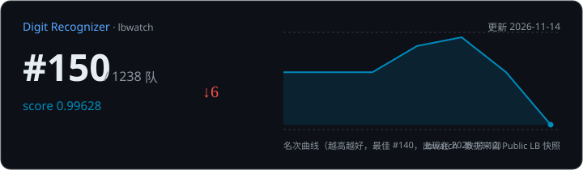
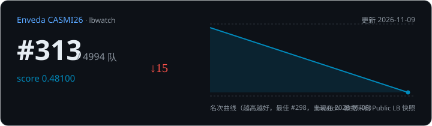
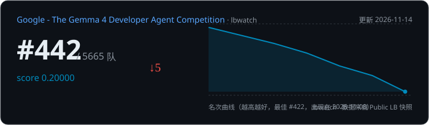
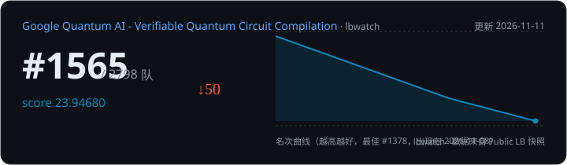
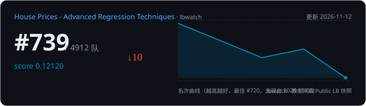
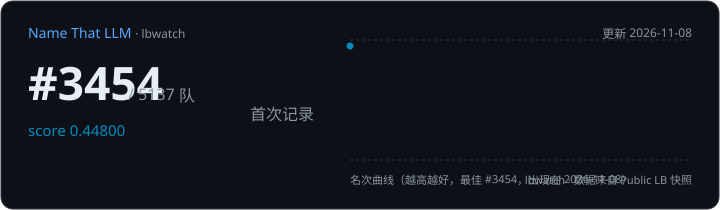
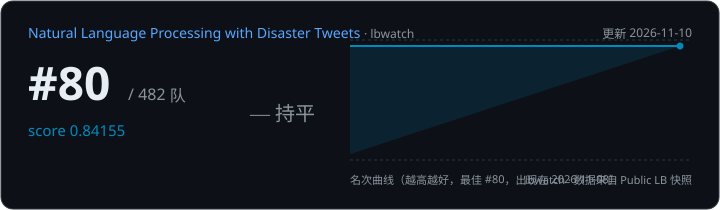
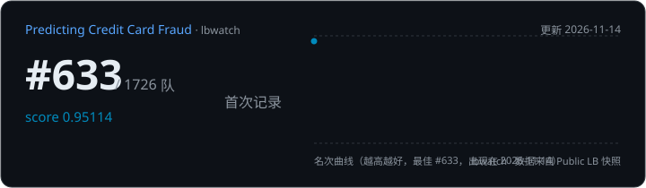

# 🏆 lbwatch — Kaggle 排行榜每日监视器

<!-- lbwatch:start -->
### 📋 盯着的比赛

| 比赛 | 我的名次 | 较上次 | 分数 | 更新 |
|---|---|---|---|---|
| [Natural Language Processing with Disaster Tweets](https://www.kaggle.com/competitions/nlp-getting-started/leaderboard) | #91 / 563 | ↓4 | 0.84155 | 11-14 |
| [Digit Recognizer](https://www.kaggle.com/competitions/digit-recognizer/leaderboard) | #150 / 1238 | ↓6 | 0.99628 | 11-14 |
| [Google - The Gemma 4 Developer Agent Competition](https://www.kaggle.com/competitions/gemma-4-developer-agent/leaderboard) | #442 / 5665 | ↓5 | 0.20000 | 11-14 |
| [Predicting Credit Card Fraud](https://www.kaggle.com/competitions/playground-series-s6e11/leaderboard) | #633 / 1726 | — | 0.95114 | 11-14 |
| [House Prices - Advanced Regression Techniques](https://www.kaggle.com/competitions/house-prices-advanced-regression-techniques/leaderboard) | #761 / 4909 | ↓7 | 0.12120 | 11-14 |
| [Enveda CASMI26](https://www.kaggle.com/competitions/enveda-CASMI26-molecule-id-mass-spectra/leaderboard) | #803 / 5249 | ↓93 | 0.48700 | 11-14 |
| [Google Quantum AI - Verifiable Quantum Circuit Compilation](https://www.kaggle.com/competitions/google-verifiable-quantum-circuit-compilation/leaderboard) | #1802 / 3008 | ↓65 | 23.94680 | 11-14 |
| [Name That LLM](https://www.kaggle.com/competitions/name-that-llm/leaderboard) | #3380 / 5801 | ↓81 | 0.55000 | 11-14 |
| [Spaceship Titanic](https://www.kaggle.com/competitions/spaceship-titanic/leaderboard) | — | — | — | 11-14 |

<details>
<summary>🖼 全部排名卡片（8 张）</summary>










</details>
<!-- lbwatch:end -->

一个推到 GitHub 就能跑的 Kaggle Public LB（公共排行榜）监视器：每天定时抓一次全量排行快照存进仓库，自动算出**你的名次变化、谁超过了你、你反超了谁**，并产出两种可视化：

| 产物 | 说明 |
|---|---|
| 📊 **Streamlit 仪表盘** | 我的名次/分数曲线、每日变化记录（谁超过我、爬升榜、榜一易主） |
| 🪪 **README SVG 卡片** | 暗色风排名卡片，Actions 每天自动刷新，可直接嵌入 README |

灵感与融合：[Satoshi-Sh/leaderboard-tracker](https://github.com/Satoshi-Sh/leaderboard-tracker)（Actions 定时 + Streamlit）、[caezium/kaggle-card](https://github.com/caezium/kaggle-card)（个人排名 SVG 卡片）、[teticio/leaderboard](https://github.com/teticio/leaderboard)（竞速动画，roadmap）。

---

## 快速开始（GitHub Actions，零服务器）

1. **把本仓库推成你自己的 GitHub 仓库**（私有模板仓库后 push，或 fork 后重建）
2. 配置 `config.yaml`（复制 `config.example.yaml`）：

   ```yaml
   teams:
     - "你的队伍名"          # Public LB 上的 TeamName
   competitions:
     - slug: santa-2025-puzzle   # kaggle.com/competitions/ 后面那串
   ```

3. 加 Kaggle 凭证 secrets：仓库 **Settings → Secrets and variables → Actions**
   - `KAGGLE_API_TOKEN`（推荐）：在 [kaggle.com/settings/api](https://www.kaggle.com/settings/api) → API → *Generate New Token*，复制以 `KGAT_` 开头的 token
   - 或 Legacy 方式 `KAGGLE_USERNAME` + `KAGGLE_KEY`（设置页 *Create Legacy API Key* 生成的 `kaggle.json` 三个字段）
4. 仓库 **Settings → Actions → General → Workflow permissions** 勾选 *"Read and write permissions"*（否则无法自动提交数据）

之后每天北京时间约 06:15 自动跑一次：抓快照 → diff 出变化 → 更新 `data/` → 自动 commit。也可在 Actions 页面手动 *Run workflow* 触发。

> 没配凭证时工作流会自动跑 **demo 合成数据**，先把整条链路跑通给你看，配好 secrets 后自动切真实抓取。

### 本地使用

```bash
pip install -r requirements.txt
cp config.example.yaml config.yaml   # 改成你的队伍名和比赛

python -m lbwatch demo    # 无凭证演示：60 天合成数据
python -m lbwatch run     # 真实抓取（KAGGLE_API_TOKEN / ~/.kaggle/access_token / legacy kaggle.json 均可）
python -m lbwatch card    # 仅重新生成卡片

streamlit run app/main.py  # 打开仪表盘 http://localhost:8501
```

### Streamlit 云端部署（可选）

走 [Streamlit Community Cloud](https://docs.streamlit.io/streamlit-community-cloud)（免费，要求仓库公开）：

- Repository / Branch / **Main file: `app/main.py`**

部署后仪表盘会随仓库里 `data/` 的每日更新而自动刷新。

---

## README 嵌入卡片

```markdown

```

卡片内容：当前名次 / 参赛人数 / 分数 / 与上次的 ↑↓ 变化 / 全程名次曲线（越高越好，标注历史最佳及日期）。

---

## 数据结构（仓库即数据库）

```
data/<slug>/
├── history.csv          # 长表: date, rank, team_id, team, score
│                        #   每日记录 top history_top 名 + 你的队伍（同日重跑幂等）
├── snapshot/2026-11-08.csv   # 逐日全量快照（可配 keep_snapshots 裁剪）
├── latest.json          # 我方最新名次/变化元数据（卡片、仪表盘共用）
└── card.svg             # README 卡片
```

diff 分析包含：我的名次/分数变化、首次上榜提示、与我名次线交叉的队伍（超过我 / 我反超）、全场爬升下跌 Top5、榜一易主。日常增量运行的 diff 基线取自最近一次已存快照。

## 配置项

| 项 | 默认 | 说明 |
|---|---|---|
| `teams` | 必填 | 队伍名，大小写不敏感；精确匹配优先，唯一子串命中兜底；多队伍取名次最好那支进卡片/指标 |
| `competitions[].slug` | 必填 | 比赛 slug |
| `competitions[].name` | =slug | 展示名 |
| `fetch.discover` | `active` | **自动发现模式**：每次运行自动拉取「我已加入的比赛」列表并入追盯范围（`off` 全手动 / `active` 只盯未截止 / `all` 含已结束）。你 join 了新比赛后**无需改任何配置**，下一轮自动开盯 |
| `fetch.exclude` | [] | 自动发现黑名单（不想盯的 slug） |
| `fetch.history_top` | 2000 | history.csv 每日保留的队伍上限（你的队伍永远保留） |
| `fetch.keep_snapshots` | 0 | 逐日快照保留天数，0=永久 |

## 已知限制

- 只支持 **Public LB**（Private 终榜要到比赛结束才存在，属 roadmap）
- GitHub Actions 的 cron 有官方抖动（±几分钟到几十分钟），不保证准点
- 全量 LB 通过 `kaggle>=2.2.5` 的 sdk 分页拉取（服务端每页上限 200 条）；认证兼容 KGAT token / Legacy key / OAuth
- 分数并列时名次以 Kaggle 官方返回顺序为准，不做本地重排

## Roadmap（P2）

- [ ] Flourish Bar Chart Race 竞速 CSV 导出
- [ ] 变化推送（Telegram / Server酱 / Discord / 邮件）
- [ ] 比赛结束后抓 Private 终榜 + public→private shakeup 分析
